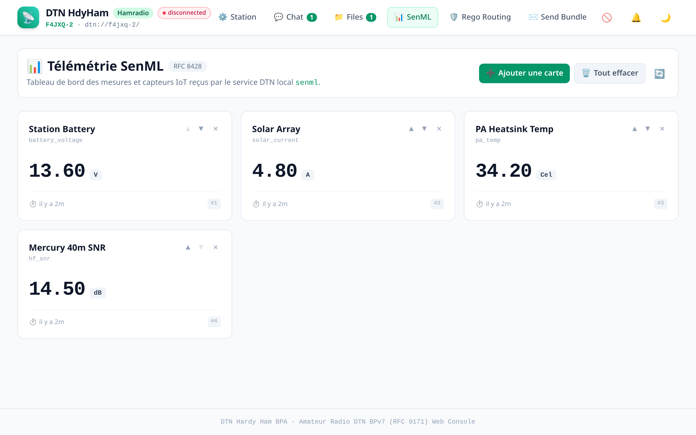

# dtnpm-mod-senml

Fullstack **DTN SenML Telemetry** (RFC 8428) plugin for **DTN Postmaster** (`dtnpm`), implementing `dtnpm_web_core::WebModule`.

## Screenshot



## Features

- **SenML Parser (`parser`)**: Decodes RFC 8428 CBOR and JSON SenML packs and extracts measurements.
- **BPA Service (`SenmlService`)**: Registers `dtn://<node>/senml`, verifies inbound bundles via directional BPsec policies, and stores telemetry packs.
- **SQLite Storage (`SenmlStorage`)**: Provides `migrations/0001_senml_schema.sql` over the shared SQLite connection.
- **HTTP API (`/api/senml/v1/...`)**: Query historical telemetry, inspect metadata/sources, publish SenML bundles, stream live updates over SSE, and serve Open MCT telemetry views.
- **Standalone Mode**: Includes `dtnpm-mod-senml` daemon (`cli` feature) and `examples/test_server.rs`.
- **WebUI Component (`ui/`)**: Preact `<SenmlView />` component and Playwright E2E spec.

## Build and Test

Requires sibling checkouts of `../dtnpm-core`, `../dtnpm-web-core`, and `../../hardy/*`.

```bash
cargo test --all-targets
```

Run the standalone mock server example:

```bash
cargo run --example test_server
```

## Security & Compliance

- **RFC 8428 & RFC 8949 Standards Compliance**: Strict validation of `bver == 10`, non-finite float rejection (`NaN`, `Infinity`), accurate handling of `s`/`bs` accumulators, and bounded telemetry packs (2 MiB / 1,000 records max).
- **Transactional Ingestion**: Atomically persisted records in a single SQLite transaction avoiding partial writes on stream disconnects.
- **Cyber Resilience Act (CRA)**: `yaml_serde` configuration storage, token file security (`--token-file`), VEX audit documentation (`RUSTSEC-2026-0459`), and SHA-pinned CI actions.
- **Rust Quality Standards**: 100% `unwrap`-free and `panic!`-free production codebase.
- **Documentation**: See [`AGENTS.md`](AGENTS.md), [`CONTRIBUTING.md`](CONTRIBUTING.md), [`SECURITY.md`](SECURITY.md), and Architectural Decision Records in [`adr/`](adr/).

## License

Dual-licensed under the Apache License, Version 2.0 or the MIT License (crate metadata: `Apache-2.0`). See [LICENSE.md](LICENSE.md).
